# Mapa Conceptual: Arquitectura IoT

## 🌐 Arquitectura del Internet de las Cosas (IoT)

La arquitectura IoT organiza los componentes que permiten **capturar datos del entorno, comunicarlos, procesarlos y utilizarlos en aplicaciones**.

```mermaid
flowchart TD
    A["🌐 ARQUITECTURA IoT"] --> B["1. CAPA DE PERCEPCIÓN"]
    B --> C["2. CAPA DE RED"]
    C --> D["3. CAPA EDGE / PROCESAMIENTO"]
    D --> E["4. CAPA DE APLICACIÓN"]

    B --> B1["Dispositivos"]
    B --> B2["Protocolos"]
    B --> B3["Tecnologías"]
    B --> B4["Ejemplo"]

    C --> C1["Dispositivos"]
    C --> C2["Protocolos"]
    C --> C3["Tecnologías"]
    C --> C4["Ejemplo"]

    D --> D1["Dispositivos"]
    D --> D2["Protocolos"]
    D --> D3["Tecnologías"]
    D --> D4["Ejemplo"]

    E --> E1["Dispositivos"]
    E --> E2["Protocolos"]
    E --> E3["Tecnologías / Plataformas"]
    E --> E4["Ejemplo"]

    B1 --> B1a["Sensores: temperatura, humedad, movimiento, luz"]
    B1 --> B1b["Actuadores: motores, relés, LEDs, válvulas"]
    B1 --> B1c["Microcontroladores: ESP32, Arduino"]
    B2 --> B2a["Bluetooth / BLE"]
    B2 --> B2b["ZigBee"]
    B2 --> B2c["LoRa / LoRaWAN"]
    B3 --> B3a["ESP32"]
    B3 --> B3b["Arduino"]
    B4 --> B4a["Sensor de humedad del suelo que mide un cultivo"]

    C1 --> C1a["Routers, gateways y puntos de acceso"]
    C1 --> C1b["Módulos de comunicación"]
    C2 --> C2a["Wi-Fi"]
    C2 --> C2b["Bluetooth"]
    C2 --> C2c["ZigBee"]
    C2 --> C2d["LoRaWAN"]
    C2 --> C2e["MQTT / CoAP / HTTP"]
    C3 --> C3a["Raspberry Pi como gateway"]
    C3 --> C3b["Gateways IoT"]
    C4 --> C4a["El gateway recibe datos de sensores y los envía a la nube"]

    D1 --> D1a["Gateways"]
    D1 --> D1b["Raspberry Pi"]
    D1 --> D1c["Computadoras o servidores locales"]
    D2 --> D2a["MQTT"]
    D2 --> D2b["CoAP"]
    D2 --> D2c["HTTP"]
    D3 --> D3a["Procesamiento local"]
    D3 --> D3b["Filtrado y análisis de datos"]
    D3 --> D3c["Edge Computing"]
    D4 --> D4a["Una Raspberry Pi analiza temperatura localmente y activa un ventilador"]

    E1 --> E1a["Computadoras"]
    E1 --> E1b["Teléfonos y tablets"]
    E1 --> E1c["Paneles de control"]
    E2 --> E2a["HTTP / HTTPS"]
    E2 --> E2b["MQTT"]
    E3 --> E3a["AWS IoT"]
    E3 --> E3b["Azure IoT"]
    E3 --> E3c["Servicios de nube"]
    E4 --> E4a["Una aplicación muestra la temperatura y permite controlar dispositivos"]

    B -. "Datos del entorno" .-> C
    C -. "Comunicación" .-> D
    D -. "Datos procesados" .-> E
```



---

## 1. Capa de Percepción

**Función:** Es la capa encargada de interactuar directamente con el entorno físico. Captura información mediante sensores y puede ejecutar acciones mediante actuadores.

- **Dispositivos:** sensores de temperatura, humedad, movimiento, luz, presión, cámaras y actuadores como motores, relés, LEDs y válvulas.
- **Microcontroladores:** ESP32, Arduino y otros dispositivos embebidos.
- **Protocolos:** Bluetooth/BLE, ZigBee y LoRa/LoRaWAN, dependiendo del alcance y consumo requerido.
- **Tecnologías:** ESP32 y Arduino.
- **Ejemplo práctico:** en un sistema de agricultura inteligente, un sensor de humedad del suelo mide las condiciones de un cultivo y un actuador puede abrir una válvula de riego.

---

## 2. Capa de Red

**Función:** Permite transportar los datos obtenidos por los dispositivos hacia otros dispositivos, gateways, servidores o servicios en la nube.

- **Dispositivos:** routers, puntos de acceso, gateways y módulos de comunicación.
- **Protocolos:** Wi-Fi, Bluetooth, ZigBee, LoRaWAN, MQTT, CoAP y HTTP/HTTPS.
- **Tecnologías:** Raspberry Pi puede utilizarse como gateway para recibir información de sensores y transmitirla a otro sistema.
- **Ejemplo práctico:** los sensores de un invernadero envían sus mediciones a un gateway mediante Wi-Fi o ZigBee. El gateway posteriormente transmite los datos hacia un servidor o plataforma IoT.

---

## 3. Capa Edge / Procesamiento

**Función:** Procesa los datos cerca del lugar donde se generan. Esto permite reducir la latencia, filtrar información innecesaria y tomar decisiones sin depender completamente de la nube.

- **Dispositivos:** Raspberry Pi, gateways IoT, computadoras industriales y servidores locales.
- **Protocolos:** MQTT, CoAP y HTTP/HTTPS.
- **Tecnologías:** Edge Computing, procesamiento local, filtrado de datos y análisis en tiempo real.
- **Ejemplo práctico:** una Raspberry Pi recibe la temperatura de varios sensores, analiza los datos localmente y activa un ventilador cuando la temperatura supera un límite establecido.

---

## 4. Capa de Aplicación

**Función:** Es la capa que presenta la información al usuario y proporciona servicios basados en los datos obtenidos por el sistema IoT.

- **Dispositivos:** computadoras, teléfonos, tablets y paneles de control.
- **Protocolos:** HTTP/HTTPS y MQTT, entre otros.
- **Tecnologías y plataformas:** AWS IoT, Azure IoT y servicios de nube para almacenar, analizar y visualizar datos.
- **Ejemplo práctico:** una aplicación móvil muestra al agricultor la temperatura y humedad del cultivo, genera alertas y permite supervisar o controlar el sistema de riego.

---

# 🔄 Ejemplo práctico completo: Agricultura inteligente

```text
┌──────────────────────────┐
│  CAPA DE PERCEPCIÓN      │
│                          │
│  Sensor de humedad       │
│  Sensor de temperatura   │
│  ESP32                   │
└────────────┬─────────────┘
             │
             │ Wi-Fi / ZigBee
             ▼
┌──────────────────────────┐
│  CAPA DE RED             │
│                          │
│  Router / Gateway        │
│  MQTT                    │
└────────────┬─────────────┘
             │
             │ MQTT / HTTP
             ▼
┌──────────────────────────┐
│  EDGE / PROCESAMIENTO    │
│                          │
│  Raspberry Pi             │
│  Filtrado y análisis     │
│  Decisiones locales      │
└────────────┬─────────────┘
             │
             │ Datos procesados
             ▼
┌──────────────────────────┐
│  CAPA DE APLICACIÓN      │
│                          │
│  Plataforma IoT / Nube   │
│  Panel web o aplicación  │
│  AWS IoT / Azure IoT     │
└──────────────────────────┘
```

### ¿Cómo funciona?

1. Los **sensores** miden la humedad y temperatura del cultivo.
2. El **ESP32** recopila las mediciones.
3. Los datos viajan mediante **Wi-Fi o ZigBee** hacia un gateway.
4. La **Raspberry Pi** recibe y procesa la información.
5. Mediante **MQTT o HTTP**, los datos pueden enviarse a una plataforma IoT.
6. La aplicación muestra los datos en un **panel web o dispositivo móvil**.
7. Si la humedad es demasiado baja, el sistema puede activar un **actuador**, como una válvula de riego.

---

## 📌 Resumen de las capas

| Capa | Función principal | Dispositivos | Protocolos / tecnologías | Ejemplo |
|---|---|---|---|---|
| **Percepción** | Capturar datos y actuar sobre el entorno | Sensores, actuadores, ESP32, Arduino | BLE, ZigBee, LoRa | Medir humedad del suelo |
| **Red** | Transportar los datos | Routers, gateways | Wi-Fi, ZigBee, LoRaWAN, MQTT, HTTP | Enviar datos del sensor |
| **Edge / Procesamiento** | Procesar datos cerca de su origen | Raspberry Pi, gateways, servidores locales | MQTT, CoAP, HTTP | Analizar temperatura localmente |
| **Aplicación** | Mostrar información y ofrecer servicios | PC, móvil, tablet, dashboard | HTTP/HTTPS, MQTT | Monitorear y controlar el cultivo |

> **Nota:** El modelo de tres capas utiliza Percepción, Red y Aplicación. El modelo de cinco capas agrega principalmente **Transporte, Procesamiento y Aplicación**, y en implementaciones modernas también suele incorporarse el concepto de **Edge Computing**. En este mapa se utiliza Edge/Procesamiento como capa intermedia para representar el procesamiento cercano a los dispositivos.
