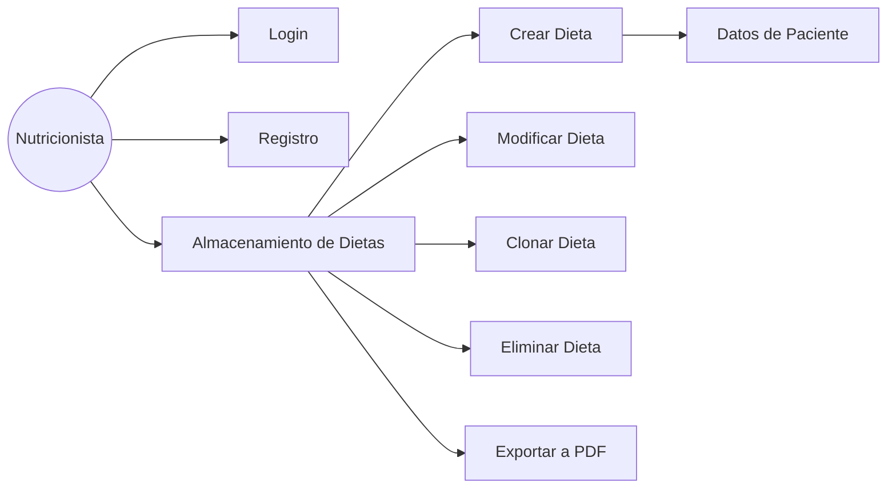
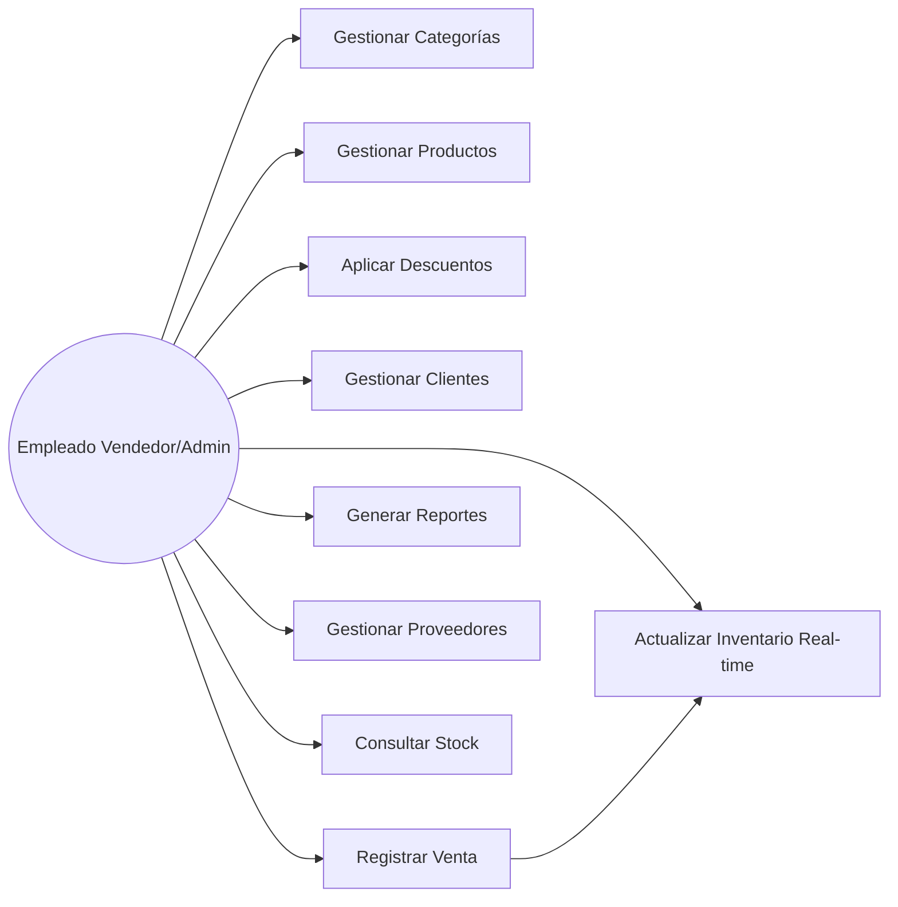

# P01 — Reporte de Calidad de SW
### Contenido base para armar la presentación (PPT → PDF)

> ⚠️ Este documento es el **contenido fuente** para construir el PPT, no el entregable final.
> El entregable final debe ser un PDF nombrado: `SC_D04_P01_Txx_ProyName.pdf`
> (sustituye `Txx` por tu número de equipo real).

---

## 1. Portada

- **Materia:** Calidad de Software
- **Sección:** D04
- **Equipo:** Txx *(pendiente — número de equipo)*
- **Integrantes:** *(pendiente — nombres completos de los 5 integrantes)*
- **Proyectos reportados:** NutriMaker (Proyecto A) · Trapitos (Proyecto B)
- **Fecha:** *(fecha de entrega)*

---

## 2. Descripción del proyecto

### Proyecto A — NutriMaker

Sistema de escritorio (JavaFX + Oracle Autonomous Database) para nutricionistas, orientado a la generación automática de dietas personalizadas. Permite iniciar sesión, registrar datos de pacientes, generar dietas automáticamente según parámetros nutricionales (calorías, objetivo, restricciones alimenticias, actividad física), así como modificar, clonar, eliminar y exportar dietas a PDF.

### Proyecto B — Trapitos

Sistema de escritorio local (Python + Tkinter + SQLite) desarrollado para el cliente Ricardo García, dueño de la tienda de ropa "Mis Trapitos". Reemplaza el manejo manual en Excel, controlando inventario por talla/color, ventas, clientes, proveedores, promociones y reportes operativos. Opera 100% sin conexión a internet, con base de datos local.

---

## 3. Objetivos del proyecto (+ Matriz de requerimientos)

### Objetivos — NutriMaker
- Automatizar la generación de dietas personalizadas según parámetros del paciente.
- Permitir gestión completa del ciclo de vida de una dieta (crear, modificar, clonar, eliminar, exportar).
- Garantizar seguridad de acceso (login, registro, cifrado de credenciales).

### Objetivos — Trapitos
- Reemplazar el control manual (Excel) por un sistema centralizado de inventario y ventas.
- Actualizar inventario en tiempo real al registrar ventas.
- Ofrecer reportes operativos (ventas, inventario, clientes frecuentes, utilidades).

### Matriz de requerimientos — NutriMaker

> ⚠️ Prioridad marcada como *(sugerida)* — no está definida en la documentación original; confirmar con el equipo antes de la entrega final.

| Id | Tipo | Funcionalidad | Requerimiento | Prioridad | Comentarios | Id_Test_Case_Satisfied |
|---|---|---|---|---|---|---|
| RF-01 | Funcional | Login | Validar correo/contraseña, cifrado AES-128 + TLS 1.2 | Alta (sugerida) | Implementado en código (`LoginController`) | *(pendiente)* |
| RF-02 | Funcional | Registro | Alta de usuario con validación de correo y contraseña | Alta (sugerida) | Implementado (`SignUpController`) | *(pendiente)* |
| RF-03 | Funcional | Almacenamiento de Dietas | Listar, crear, exportar, clonar, modificar, eliminar dietas | Alta (sugerida) | Implementado (`DietStorageController`) | *(pendiente)* |
| RF-04 | Funcional | Crear Dieta | Generación automática según calorías, objetivo, restricciones | Alta (sugerida) | Implementado (`CreateDietController`) | *(pendiente)* |
| RF-05 | Funcional | Datos de Paciente | Captura de nombre, altura, edad, peso | Media (sugerida) | Implementado (`PatientFormController`) | *(pendiente)* |
| RF-06 | Funcional | Modificar Dieta | Edición de alimentos con regeneración automática | Media (sugerida) | Implementado | *(pendiente)* |
| RF-07 | Funcional | Clonar Dieta | Duplicar dieta existente | Baja (sugerida) | Implementado | *(pendiente)* |
| RF-08 | Funcional | Eliminar Dieta | Confirmación + baja de dieta | Media (sugerida) | Implementado | *(pendiente)* |
| RF-09 | Funcional | Exportar a PDF | Generación y vista previa de PDF de la dieta | Media (sugerida) | Implementado (`PDFBuilder`) | *(pendiente)* |

### Matriz de requerimientos — Trapitos

> ✅ Datos reales del documento IEEE830 del proyecto original. La columna **Id_Test_Case_Satisfied** corresponde a su matriz de rastreabilidad.
> ⚠️ El estado "Implementado" refleja lo reportado por el equipo que desarrolló el código, **no verificado con pruebas automatizadas** (el repo actual no tiene carpeta de tests ni CI).

| Id | Tipo | Funcionalidad | Requerimiento | Prioridad | Comentarios | Id_Test_Case_Satisfied |
|---|---|---|---|---|---|---|
| RF-01 | Funcional | Productos | Registrar productos con categoría, precio, talla, color | Alta | `save_product()` | PR-FUNC-01 |
| RF-02 | Funcional | Productos | Variaciones de talla/color con control de existencias | Alta | `save_product()` | PR-FUNC-02 |
| RF-03 | Funcional | Productos | Agregar productos y actualizar cantidades | Alta | `save_product()` | PR-FUNC-03 |
| RF-04 | Funcional | Ventas | Actualizar inventario en tiempo real al vender | Alta | `register_sale()` | PR-FUNC-04 |
| RF-05 | Funcional | Inventario | Registrar movimientos de inventario | Alta | `register_movement()` | PR-FUNC-05 |
| RF-06 | Funcional | Ventas | Registrar ventas con productos/cantidades/pago | Alta | `register_sale()` | PR-FUNC-06 |
| RF-07 | Funcional | Ventas | Pagos en efectivo, tarjeta, transferencia | Alta | `PAYMENT_METHODS` | PR-FUNC-07 |
| RF-08 | Funcional | Ventas | Aplicar descuentos a ventas | Alta | `discount_amount` | PR-FUNC-08 |
| RF-09 | Funcional | Promociones | Registrar promociones (%, duración) | Media | `save_promotion()` | PR-FUNC-09 |
| RF-10 | Funcional | Promociones/Ventas | Descuentos automáticos según condiciones | Media | `active_promotion_percent()` | PR-FUNC-10 |
| RF-11 | Funcional | Clientes | Registrar clientes (nombre, dirección, correo, tel.) | Alta | `save_customer()` | PR-FUNC-11 |
| RF-12 | Funcional | Clientes/Reportes | Historial de compras por cliente | Alta | `customer_history()` | PR-FUNC-12 |
| RF-13 | Funcional | Proveedores | Registrar proveedores y contacto | Media | `save_supplier()` | PR-FUNC-13 |
| RF-14 | Funcional | Productos/Proveedores | Relacionar proveedor con productos suministrados | Media | campo `supplier_id` | PR-FUNC-14 |
| RF-15 a RF-26 | Funcional | Reportes | 12 reportes operativos (stock, ventas, clientes, utilidades, etc.) | Media/Baja | Función `report()` con 12 variantes | PR-FUNC-15 a PR-FUNC-26 |
| RNF-01 | No funcional | Ventas/Inventario | Reflejar stock en tiempo real | Alta | Verificado en `register_sale()` | PR-RNF-01 |
| RNF-03 | No funcional | Sistema | Operar sin conexión a internet | Alta | SQLite local + Tkinter | PR-RNF-03 |
| RNF-04 | No funcional | Base de datos | Persistencia local | Alta | `mis_trapitos.db` | PR-RNF-04 |
| RNF-05 | No funcional | Arquitectura | Operar en 7 computadoras de la tienda | Media | Diseño cliente-servidor local propuesto | PR-RNF-05 *(Parcial)* |
| RNF-07 | No funcional | Interfaz | Fácil de usar para personal no técnico | Media | Interfaz Tkinter con formularios | PR-RNF-07 |
| RNF-08 | No funcional | Ventas/Inventario | Consistencia entre inventario y ventas | Alta | `register_sale()`, `return_item()`, `cancel_sale()` | PR-RNF-08 |

---

## 4. Estado actual

### NutriMaker
- Código fuente completo en Java/JavaFX, arquitectura en capas (models, controllers, repository, PDFBuilder).
- **180 commits** de historial — desarrollo incremental real.
- **Sin pruebas automatizadas** (no hay carpeta `src/test`).
- Documentación de análisis y diseño completa (specs de casos de uso, diagramas UML).
- *(pendiente: resultados de pruebas una vez que el equipo agregue JUnit + primeros tests)*

### Trapitos
- Código fuente en un solo archivo Python (1658 líneas, 87.5 KB) — **alta deuda técnica** por falta de modularización.
- Solo **2 commits** — poco historial incremental de desarrollo.
- **Sin pruebas automatizadas**, aunque el documento IEEE830 original define una matriz de rastreabilidad con IDs de prueba (PR-FUNC-XX) que **no corresponden a tests automatizados reales**, sino a verificación funcional manual reportada por el equipo original.
- Buena documentación de requerimientos (IEEE830 completo, diagramas de contexto, casos de uso, arquitectura, secuencia, ERD).

---

## 5. Porcentaje estimado de avance global

> ⚠️ El número final debe decidirlo el equipo — aquí va el argumento/framework para sustentarlo, no una cifra inventada.

**Argumento sugerido:** distinguir entre dos tipos de avance:

1. **Avance funcional** (features del negocio ya implementadas en el código) — alto en ambos proyectos, ya que son proyectos legacy reutilizados con funcionalidad ya construida.
2. **Avance de calidad de SW** (lo que en realidad mide esta materia: documentación SDD/SAD actualizada, plan de pruebas, pruebas automatizadas, dashboard, métricas) — **bajo en ambos**, porque apenas se está iniciando (WK2).

Ejemplo de argumento a desarrollar en la slide:
> *"NutriMaker tiene ~90% de avance funcional (8/8 casos de uso implementados) pero ~10% de avance en calidad de SW, ya que faltan pruebas automatizadas, SDD/SAD formalizados y dashboard de métricas — que es justo el alcance de esta asignatura."*

Aplicar el mismo razonamiento a Trapitos (26/26 RF implementados funcionalmente, pero 0% de cobertura de pruebas automatizadas).

### Diagrama de casos de uso

**NutriMaker** (8 casos de uso):

**Trapitos** (según diagrama del documento original):

---

## 6. Cronograma previo

### Trapitos (documentado en el análisis original)

| Fase | Actividad | Duración |
|---|---|---|
| Planeación | Organización del proyecto | 1 semana |
| Análisis | Revisión de requerimientos | 1 semana |
| Diseño | Diagramas y base de datos | 2 semanas |
| Desarrollo | Programación del sistema | 4 semanas |
| Pruebas | Corrección de errores | 1 semana |
| Implementación | Instalación y capacitación | 1 semana |
| **Total** | | **10 semanas** |

### NutriMaker
> ⚠️ Pendiente — no hay cronograma previo documentado en el material disponible. Si el equipo original no lo compartió, se puede reconstruir aproximado a partir de los 180 commits (fecha del primer y último commit).

---

## 7. Cronograma — Etapa de Calidad de SW (duración de la asignatura)

> ⚠️ Completar Responsable, fechas exactas y dependencias con datos reales de tu equipo. Estructura mínima requerida por la rúbrica:

| Actividad | Responsable | Duración | Fecha inicio | Fecha término | Dependencias |
|---|---|---|---|---|---|
| Evaluación inicial de proyecto + métricos a evaluar | *(pendiente)* | 1 semana | WK2 | WK2 | — |
| Software Design Document (creación/actualización) | *(pendiente)* | *(pendiente)* | *(pendiente)* | *(pendiente)* | Evaluación inicial |
| Software Architecture Document | *(pendiente)* | *(pendiente)* | *(pendiente)* | *(pendiente)* | SDD |
| SW Test Plan | *(pendiente)* | *(pendiente)* | *(pendiente)* | *(pendiente)* | SAD |
| Test Report | *(pendiente)* | *(pendiente)* | *(pendiente)* | *(pendiente)* | SW Test Plan |
| Creación de dashboard (GitHub Project org SQEquipo3) | *(pendiente — ya en progreso)* | *(pendiente)* | WK2 | *(pendiente)* | — |
| Monitoreo y actualización de métricos | *(pendiente)* | Semanal, todo el semestre | WK2 | Fin de asignatura | Dashboard creado |

> Nota: marcar aquí los **milestones** (cortes de presentación de timing plan ante el grupo) que pide la rúbrica de "Fondo".

---

## Checklist antes de exportar a PDF

- [ ] Nombres reales de los 5 integrantes y número de equipo en portada
- [ ] Prioridades de NutriMaker confirmadas por el equipo (actualmente son sugerencias)
- [ ] % de avance decidido por el equipo con el argumento de la sección 5
- [ ] Fechas reales de WK2 en adelante en la tabla de la sección 7
- [ ] Capturas de pantalla del GitHub Project (dashboard) insertadas
- [ ] Diagrama de Gantt real (no solo tabla) — usar Excel/PowerPoint/GitHub Roadmap view
- [ ] Archivo exportado como PDF con nombre `SC_D04_P01_Txx_ProyName.pdf`
